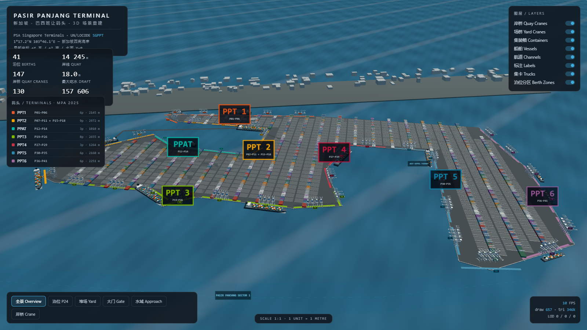

# PPT 3D · Three.js 版本（方案 B）

新加坡巴西班让码头（Pasir Panjang Terminal）1:1 米制三维场景重建，浏览器端实时渲染。



---

## 1. 运行

纯静态站点，无需构建。任选一种方式启动本地服务器（**不能直接双击 index.html**，ES Module + fetch 需要 HTTP）：

```bash
# 方式一：Python
cd PPT3D_ThreeJS
python -m http.server 8765
# 浏览器打开 http://127.0.0.1:8765

# 方式二：Node
npx serve .
```

要求：Chrome / Edge / Firefox 等支持 WebGL2 与 importmap 的现代浏览器。

首次加载约 1.5 s（含 9 万个集装箱实例的生成），之后全部在内存中，无外部请求。

---

## 2. 操作

| 操作 | 说明 |
|---|---|
| 左键拖拽 | 旋转 |
| 右键拖拽 | 平移 |
| 滚轮 | 缩放（40 m – 14 km） |
| 底部按钮 | 6 个机位：全景 / 泊位 P24 / 堆场 / 大门 / 水域进港 / 岸桥特写 |
| 右上图层开关 | 岸桥、场桥、集装箱、船舶、航道、标注、集卡、**泊位分区** |
| 左上码头表 | 7 个码头的泊位区间、泊位数、岸线长（点击无操作，纯图例） |
| **面板标题栏** | 点击即折叠/展开该面板，折叠状态写进 `localStorage`（`ppt.hud.v1`），刷新后保留 |

**手机 / 窄屏（≤ 820 px）**：所有面板默认折叠成一行行小卡片，横向自动换行，只占顶部约 120–150 px；展开的卡片独占一行并把其余卡片下推。`#scale` 比例尺在窄屏隐藏，机位按钮改为可横向滑动的单行。竖屏时相机会自动加宽垂直视场（上限 72°）并按比例后撤，避免 16:9 的取景被裁掉两侧。

右下角实时显示 FPS、绘制调用数、三角面数与当前 LOD 分布（近/中/远）。

---

## 3. 场景内容

| 类别 | 数量 | 说明 |
|---|---|---|
| 陆地 | 1 块 | **197 顶点**多边形，由 OSM 官方港口多边形（way 325897191 + 868420646）∩ z18 影像陆地提取；面积 **574 ha**，与 PSA 公布的 576 ha 差 0.3% |
| 港池 | 1 个 | Pasir Panjang Basin，夹在北突堤与西侧主块之间，向西北开口 |
| 泊位 | 41 | P01–P41，按 MPA 实测长度铺在岸线上（泊位间均分 **13.6 m** 空档），标签按**所属码头**着色；泊位箱长合计 **14 244 m** |
| 码头分区 | 7 | PPT1–PPT6 + PPAT，码头正面有 17 m 宽的彩色压条 + 泊位分界刻线；名牌落在各自堆场区（非岸线上） |
| 岸线 | 1 条**开放**链 / **14 805 m** | 起点在**北突堤最西端**（= P01 / PPT1 起点），终点在东南臂东北角，**不在城市一侧闭合**；压顶梁、护舷、系缆桩只沿岸线铺设 |
| 岸桥 | 147 | 两种规格（24 排 / 18 排），合并网格 + 实例化 |
| 堆场箱区 | **619** | 按卫星影像的过道格网逐块量出（见 `docs/ppt_yard_lattice.svg`）：西块 246×19.5 m（26 车道）、北岸 118×32 m（7 车道）、连接段 210×34 m（10 车道）、东臂 132×30 m（16 车道）。**只有两套正交方向**：长轴 120.7°（西块、北岸）与 30.7°（连接段、东臂），每区一套车道间距、一套块长，行列严格对齐；共约 17.9 万个箱实例 |
| 场桥 | **901 台** | 按箱区建模：每个箱区一台跨式起重机，长块（≥210 m）两台，跨距随块宽 25 / 34 m。西块与北岸用轮胎式（RTG），连接段与东臂用轨道式（RMG）。PSA 公布的 130 台是另一口径，暂不采用 |
| 船舶 | 12 | 400 m ULCV、Neo-Panamax、Feeder、PCTC，全部停在水侧（泊位法线方向） |
| 航道 | 4 条 | West Keppel / Jurong / Sinki / Pasir Panjang Sector 1；岸边采样点 0 个落入陆域 |
| 大门 | — | 22 条车道 + 雨棚 + PPEIS 查验厅 + 行政楼；位于陆域内侧（离岸线 241 m） |
| 区域底图 | 39 个多边形环 | 新加坡西海岸轮廓，**1:1 米制、与 PPT 同原点**（GADM 4.1 SGP 行政区多边形，投影到本地 ENU 坐标），含 6 处地名标注 + 0.05° 经纬网；可在「图层」里关闭 |

---

## 4. 目录结构

```
PPT3D_ThreeJS/
├─ index.html              页面骨架 + HUD（暗色玻璃面板）
├─ src/
│  ├─ main.js              渲染器、相机、光照、循环、HUD 绑定、Runtime
│  ├─ geo.js               几何/材质工具：box、merge、ribbon、实例化、PRNG
│  ├─ terminal.js          陆地、岸壁、护舷、系缆桩、道路、轨道、灯杆、大门、标注
│  ├─ equipment.js         岸桥 / 场桥 / 集卡 / 船舶几何与布置
│  ├─ yards.js             集装箱箱区 + 三级 LOD
│  ├─ region.js            区域底图：海岸线填充、等高线边、经纬网、地名标注
│  └─ water.js             水面着色器、航道带、锚地、浮标、雾
├─ data/ppt_terminal.json  PPT 几何数据源（由 tools/generate_layout.mjs 生成）
├─ data/region_coast.json  西海岸轮廓（GADM 4.1，投影后按环存储）
├─ vendor/                 three.module.js + OrbitControls + BufferGeometryUtils（本地化）
└─ docs/                   预览图
```

---

## 5. 性能设计

| 手段 | 实现 |
|---|---|
| 实例化 | 集装箱、岸桥、场桥、集卡、系缆桩全部 `InstancedMesh`；147 台岸桥 = 1 次 draw call；箱区实例矩阵带朝向，两套方位共用一个几何 |
| 场内道路 | **60 条行车通道**（车道之间 12–26 m 宽的沥青带，随箱区格网生成）+ 15 条前沿道路；集卡沿这些通道行驶，不再走旧网格 |
| 铺装 | 箱区地坪与堆场铺面用同一张 24 m 周期的混凝土贴图，UV 按世界坐标投影，接缝网格跨块连续，空箱区不会退化成一块纯色板 |
| 三级 LOD | 近（单体箱）/ 中（每贝一块）/ 远（整块体量）；按相机距离切换，节流 220 ms 且仅在相机移动 >30 m 时重算 |
| **箱区空间分块** | 箱区按 **500 m** 网格合并为 chunk（29 个），每个 chunk 的三档各自合并成**单个**对象（近/中为 `InstancedMesh`，远为带顶点色的合并网格）。draw call 由「每箱区 1 个」降为「每 chunk 1 个」 |
| 几何合并 | 岸桥由 ~40 个 box 合并成单一 BufferGeometry；道路、标线、护舷各自合并为 1 个网格 |
| 剔除 | 视锥剔除默认开启；水面/远景不投影 |
| 光照 | 1 个半球光 + 2 个平行光，**无阴影贴图**（4 km 尺度的阴影贴图性价比极低） |
| 水面 | 单平面 + 极简解析着色器（2 个正弦 + Fresnel 近似），无反射探针、无 RT |
| 雾 | 线性雾 3.2–15 km，同时承担"远景降精度"的视觉掩护 |
| 像素比 | `min(devicePixelRatio, 1.75)`，避免 4K 屏 3 倍超采样 |

实测（无头 SwiftShader 软件渲染，1280×760，仅供相对比较）：**全景 339 draw calls / 33 万三角面**（分块前为 622）；堆场视角 120 / 90 万；泊位视角 91 / 88 万。三角面数不因合批而下降，但绘制调用数在全景下减少 45%。真实 GPU 上帧率取决于硬件，截图中的 10–13 FPS 是软件光栅的结果，不代表实际性能。

---

## 6. 动态化接口（预留）

`src/main.js` 内的 `Runtime` 是静态场景与未来动态仿真的解耦层：

```js
// 注册任意对象（建造阶段已完成）
runtime.register('vessel_V1', shipObject3D, { loa: 399.99, berth: 'P16' });

// 挂接每帧回调：dt 秒、t 累计秒
runtime.onTick('vessel_V1', (dt, t, entity) => {
  entity.object3d.position.y = Math.sin(t * 0.6) * 0.15;   // 示例：船舶微幅起伏
});

// 全局帧回调（适合驱动 AGV / 集卡车流）
runtime.onFrame((dt, t) => { /* ... */ });
```

浏览器控制台可直接访问：

```js
PPT.scene        // THREE.Scene
PPT.camera       // PerspectiveCamera
PPT.goView('yard')
PPT.runtime      // 上面的 Runtime 实例
PPT.yards.update(PPT.camera.position)   // 手动刷新 LOD
PPT.pickable     // { yardGroup, craneGroup, vesselGroup } 便于射线拾取
```

建议的后续动态化扩展点：
1. **岸桥**：`craneGroup` 的实例矩阵按 TOS 作业计划更新小车/吊具位置（需拆成多部件实例）；
2. **集卡**：为 `truckGroup` 建路径样条，`onFrame` 推进 `distance`；
3. **船舶**：靠离泊用 Catmull-Rom 曲线 + 拖轮推力模型；
4. **堆场**：箱区实例的可见性/颜色可按实时箱况刷新（`instanceColor` 已启用）。

---

## 6.5 泊位归属（2026-11-05 更新）

场景里的 41 个泊位不再按"示意分期"分配，而是按 MPA《Singapore Port Information 2025》p.89 的逐泊位长度，与 PSA 公布的分期泊位数/岸线长闭合后确定的真实归属：

| 码头 | 泊位 | 个 | 公布岸线 | 泊位箱合计 | 偏差 |
|---|---|---|---|---|---|
| PPT 1 | P01–P06 | 6 | 2 145 m | 2 024 | −5.6% |
| PPT 2 | P07–P11 + P15–P18 | 9 | 2 972 m | 2 973 | +0.03% |
| PPAT | P12–P14 | 3 | 1 010 m | 1 012 | +0.2% |
| PPT 3 | P19–P26 | 8 | 2 655 m | 2 625 | −1.1% |
| PPT 4 | P27–P29 | 3 | 1 264 m | 1 200 | −5.1% |
| PPT 5 | P30–P35 | 6 | 2 160 m | 2 204.5 | +2.1% |
| PPT 6 | P36–P41 | 6 | 2 251 m | 2 205.5 | −2.0% |

**几何如何处理**：整座码头是**一条连续岸线链**（北突堤 → 盆地 → 西侧主块 → 东南臂），41 个泊位按真实长度 + 均分 13.6 m 间隙依次铺满；每个泊位记录 `terminal` 字段，渲染层据此上色、编组、分配岸桥（19/36/31/13/24/24 = 147 台）和船舶靠泊位置。推导过程见 `../PPT_Plan/README.md`。

> PPAT 落在 P11 与 P15 之间，因此 PPT 2 在编号上被切成两段——图例里显示为 `P07–P11 + P15–P18`。

---

## 7. 布局校准与数据来源

**几何来源**：ESRI World Imagery **z18**（≈0.595 m/px），采用**精确 Web-Mercator 瓦片索引配准**（`lon(tx)=tx/2^z·360−180`、`lat(ty)=atan(sinh(π(1−2·ty/2^z)))`），南北两块瓦片重叠 4 行、纵向偏移 3072 px、**横向偏移 −512 px**（符号易错，见下）。在该配准下：

- 岸线取自 OSM way 557975391「Coastline of Singapore」的 **55–70 号顶点**（= PPT 临水面），逐点吸附到影像岸壁，**最大偏差 10.8 m**；
- 陆域取自 OSM 官方港口多边形 way 325897191 + 868420646 与影像陆地的交集，**574 ha**（PSA 公布 576 ha）；
- 泊位长度/水深取自 MPA《Singapore Port Information 2025》p.89。

**配准自检（可复现）**：Web-Mercator 是保角投影，因此像素空间的方位角必须等于地理方位角。旧实现中南北瓦片块的横向偏移符号取反，导致整个南半部**平移约 610 m**；该自检把所有跨接缝段的方位角偏差从 5.5°/26.9°/9.9° 降到 0.2°（仅取整误差），并让所有岸线顶点到水体的距离从数百米收敛到 ≤18 m。`.v3/verify_reg.py` 可复现。

**真实拓扑（2026-11-05 二次核定，卫星图逐段验证）**：PPT 是**一整块连续陆地**，形状像一把钩子：

1. **北侧突堤**沿 Jurong Channel 由西向东伸出，其**西南岸线自 103.76101E / 1.29039N 起**——这才是 **PPT1 / P01 的真正起点**；其东北侧与城市（高架路 + 组屋）相接，不存在岸线；
2. **Pasir Panjang Basin** 夹在北突堤与西侧主块之间，向西北开口，池头在东；
3. **西侧主块**（约 1.2 × 2.7 km）是 PPT2/3 与 PPAT，长直岸线面向西南的 West Keppel Fairway；
4. **东南臂**（PPT4/5/6）自主块东南角折向东南、再转向正南，两面临水；
5. 三者通过主块东北角的**窄颈**连成一体。

**上一版的错误**：① 把北突堤**东北侧与城市相接的边界**当成了 PPT1 的岸线（P01–P06 整段画在城市侧），真正的 PPT1 起点被错推到北突堤中部；② 陆地轮廓来自 z17 的粗分割，被切成"两个小岛"；③ 岸线被过度简化到 23 个顶点且长度虚增至 16.6 km。现在：PPT1 起点回到北突堤最西端、陆域恢复为一整块、岸线长度回到 **14.8 km**（泊位箱合计 14.24 km + 间隙），且各码头正面长度与 PSA 公布值全部闭合（偏差 ≤5.6%）。

**区域底图（2026-11-06 新增）**：背景不再是示意体块，而是真实海岸线。数据为 GADM 4.1 `gadm41_SGP_1.json`（新加坡 5 个行政区、40 个多边形环，共 921 个顶点），按 `meta.origin`（103.76E / 1.28N）用等距圆柱近似投影到本地米制坐标：

```
x = (lon − lon0) · 111320 · cos(lat0)
z = −(lat − lat0) · 110574          # +Z 向南，与场景一致
```

34 个环（面积 ≥ 0.5 ha）写入 `data/region_coast.json`，运行时三角化为一张 y = 1.2 m 的平面（低于 5 m 码头面、高于水面），叠加 0.05° 经纬网与 6 个地名。**PPT 足迹的凸包已从底图中扣除**——码头本体是带开口港池的钩形，只扣轮廓会在港池里留下底图陆地，凸包同时覆盖港池与两臂之间的水域，而这两处都是模型的「水」，扣掉不会误伤。原始 6 块「示意陆地 + 城市体块」已删除。

地名标签用 `sizeAttenuation: false`（屏幕定尺），并按相机距离逐帧抬升，避免精灵被地平面切掉下半截字。

**为什么是直线段**：真实码头的岸壁是连续直墙，只有泊位端部与转角才有折点。岸线直接采用 OSM 官方 coastline way 的 16 个顶点（每段本身就是一条直墙），只做"吸附到影像岸壁"的微调；陆域轮廓则用 12 px 容差的 Douglas-Peucker 简化，保留 197 个顶点以贴合真实的人工岸线（其中数段长达 1.4–1.5 km）。

详见根目录 `../PPT_调研报告.md` §1.3。

## 8. 已知限制

- 无阴影与环境光遮蔽，近景层次感弱于离线渲染；
- 船舶为低模（约 200 个 box/艘），近距离观察细节有限；
- 未接入真实地形/卫星影像，陆侧背景为体块示意；
- 未实现碰撞、拾取选择与属性面板（接口已预留）。
