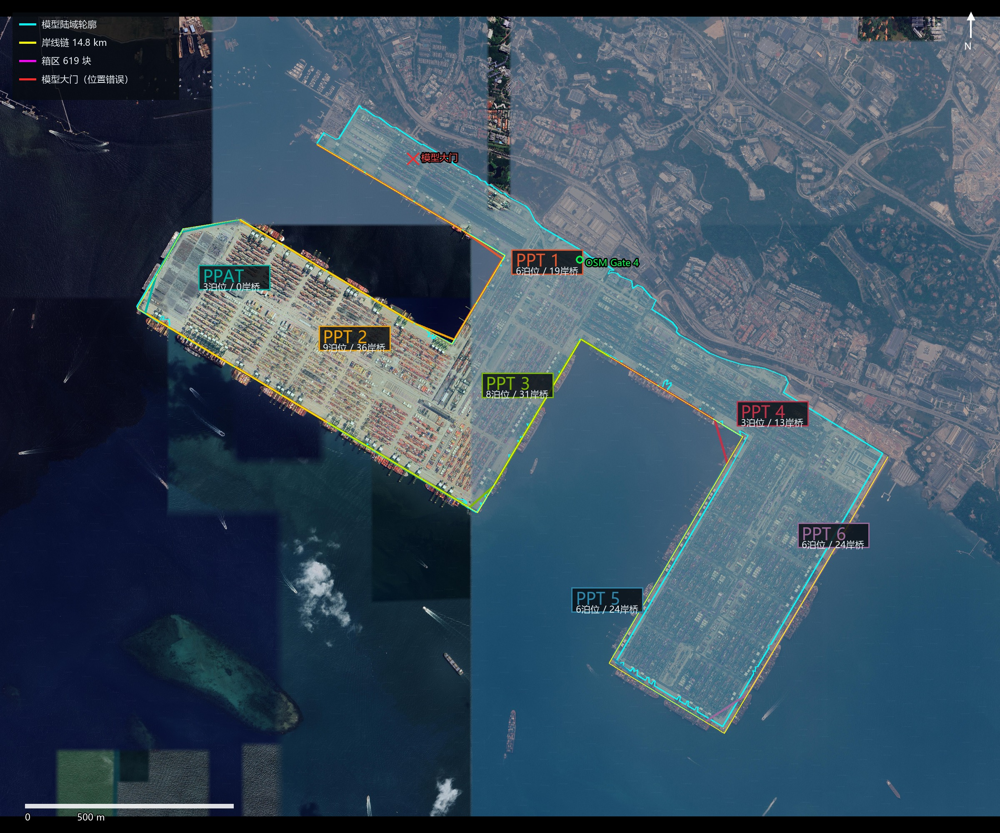
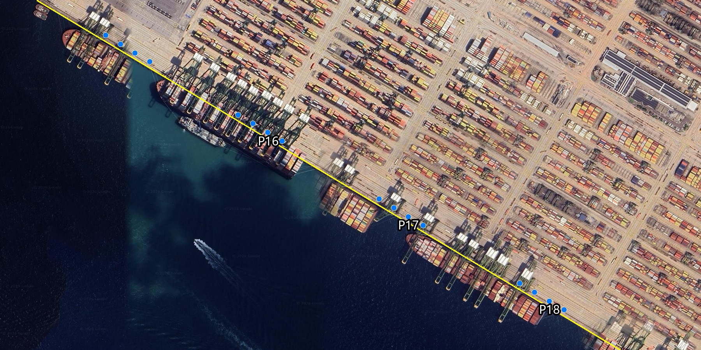
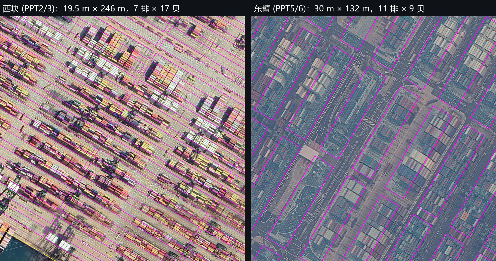
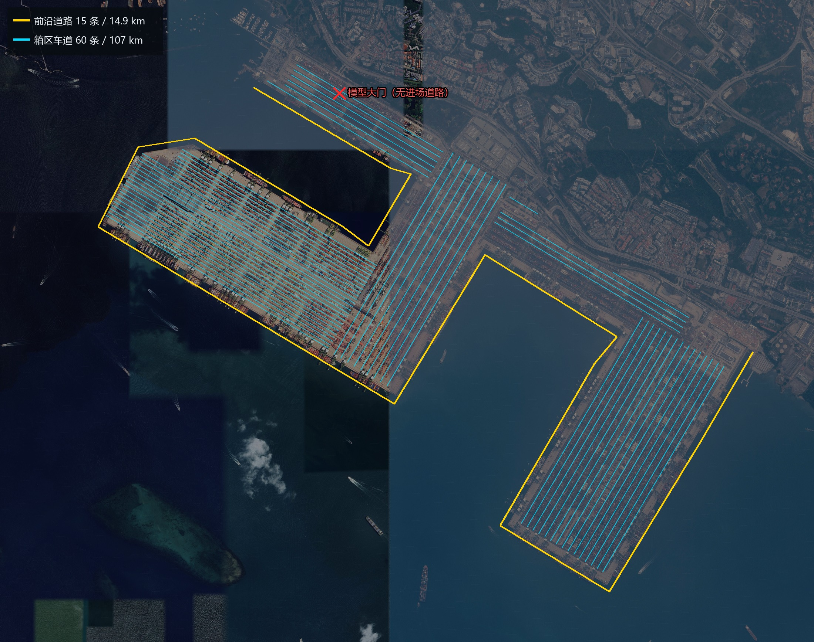

# Pasir Panjang Terminal 三维模型 vs Google 卫星影像一致性复核

- 复核对象：`SingaPort-PACE-v`（Three.js 版，`data/ppt_terminal.json` + `src/*.js`）
- 复核日期：2026-11-06
- 参照影像：Google 卫星影像 z18/z19（tile 水印 © 2026 Google），局部 0.30 m/px；辅以 OpenStreetMap 海岸线/港区/大门矢量、项目引用的 MPA/PSA 公布口径
- 配准方式：项目局部坐标 `x`（东）/`z`（南），原点 103.76E / 1.28N；按项目同一公式反算经纬度后叠加到 Web-Mercator 瓦片

> 结论先行：**宏观骨架（钩形陆域、Pasir Panjang Basin、北突堤/西块/东南臂三段、7 个码头的先后顺序）与 Google 影像高度一致；差异集中在“细粒度”层：岸线局部向海偏移 10–25 m、PPT4 岸线被压缩 14.6%、东臂箱区格网未与真实箱区对齐、场桥 901 台 vs 数据 130 台、内部道路缺主干层级且大门错位 1.3 km。**

| 维度 | 一致性 | 主要问题 |
|---|---|---|
| 岸线分段长度/位置 | **较好（8/10）** | 局部 10–25 m 向海偏移；PPT4 −14.6%；B29 被压缩 122 m；泊位间均分 13.6 m 间隙是简化 |
| 岸桥数量/分布 | **较好（7/10）** | 总量 147 与影像密度同量级；但按泊位聚簇（38 m 间距、只占泊位 22–43% 长度），B15–B18 段落在水里 |
| 箱区数量/朝向/行列 | **中等（6/10）** | 两套正交朝向正确；箱区格网整体错位约半个箱区，西块 246 m 长块跨过横向通道，东臂块与影像的分块不一致 |
| 场桥数量/分布 | **差（3/10）** | 数据写 130 台，场景实际生成 **901 台（6.9×）**；每块中心一台，密度明显高于影像 |
| 港区道路 | **差（4/10）** | 只有沿岸 15 条前沿路 + 60 条箱区车道；缺主干道/大门集疏运；模型大门距真实 Gate 4 **1.30 km** |

---

## 0. 修复记录（2026-11-06 已执行）

本报告的 P0–P2 项已在同一天修复，下列数据为**修复前**基线；当前值见 `README.md` §9。

| 项 | 修复前 | 修复后 |
|---|---|---|
| 场桥 | 901 台（数据写 130） | **440 台**：z20 卫星抽样，RTG 1 台/块、C 区 1 台/块、D 区 1 台/2 块；清除前沿/PPAT/大门箱区后重算；块端布置 |
| 大门 | (755, −1045)，北突堤箱区 | **(1830, −390)**，OSM Gate 4；广场清出；接 Avenue 2/3 |
| B15–B18 岸桥 | 后退 12 m，落水 | 后退 **20 m**，机械房进深 14→8 m |
| 主干路 | 无 | **213 段 / 26.1 km** OSM Avenue/Drive/Link |
| 西块箱区 | 246 m/块 | **2×123 m/块** |
| 岸桥分布 | 38 m 聚簇、每泊位空 104–339 m | 按码头连续岸线均布（约 80–100 m） |
| B29/B36 | 420→298、453→339 | 420→356、453→394 |

### 0.1 2026-11-06c 视觉问题修复

按实景截图逐项核实后追加：

| # | 核实 | 修复 |
|---|---|---|
| 1 船压在前沿路上 | 22 m 路幅以岸线为中心，11 m 落在水里 | 前沿路向陆偏移 13 m |
| 2 箱区/岸桥重叠 | 54 个箱区近岸边 <34 m，岸桥陆侧腿在 35.2 m | 清除近岸边 <36 m 的箱区（60 块） |
| 3 卡车穿箱/出海/横走 | 957 台中 119 台出陆、55 台压箱；车身长轴与道路差 90° | 长轴改为沿道路；逐台三点校验陆域/箱区；场内车道离箱区 >22 m 不放车；724 台，0 出陆、0 压箱 |
| 4 PPAT 有箱区 | PPAT 锚点 37 m 内即 B 区箱区 | 520×460 m（23.9 ha）清空（34 块） |
| 5 大门建筑压箱区 | Gate 4 两栋建筑旋转 −11°，压在 C 区/轨道上 | 旋转矩形相交清除（3 块） |

修复后：**720 箱区 / 440 场桥 / 160 767 箱**；`tools/fix_visual.py` 为一次性迁移脚本。

### 0.2 2026-11-06d 二次视觉修复

上一轮后仍有 6 项残余，放大 z19 影像复核后重做：

| # | 复核结论 | 修复 |
|---|---|---|
| 1 海上仍有道路/路灯 | `roads` 本身在岸线外 **45–71 m**；路灯固定放在一侧，正好在水里 | 从岸线链重建 15 条路（向陆偏 26 m、宽 14 m）；路灯放海侧路肩 |
| 2 PPT2/PPT6 岸桥局部压箱区 | **B07/B34/B14 法线与切向平行**（点积 0.99/0.99/−0.23），岸桥转 90° | 法线改为垂直切向+指向水域；岸桥按所在折线段取法线 |
| 3 PPT4/5/6 岸桥不在陆地 | 陆域多边形在东臂比岸线**内缩 36–46 m** | 沿整条岸线加 **180 m 岸壁/前沿板**（带 6 m 岸壁），岸桥/道路落在板上 |
| 4 水平路比竖直路细 | 场内车道 30° 均宽 **24.0 m**、120° 均宽 **11.8 m** | 60 条车道统一 **13 m** |
| 5 PPT2 缺仓库 | 影像上有约 250×200 m 的 U 形仓库（北/东/南三翼） | 按 U 形三翼加 3 栋仓库（250×50 + 50×200 + 250×50），清除 19 块箱区；**后被 §0.3 修正：该建筑是 MAY，已删除** |
| 6 缺对比手段 | — | 新增 **卫星底图图层**：z18 影像重采样 4096×3218，y=5.5 m，图层面板可开关 |

修复后：**660 箱区 / 410 场桥 / 153 175 箱**；页面内复算 147 台岸桥 0 台压箱区、843 台卡车 0 台出陆/压箱。

### 0.3 2026-11-07 卫星底图逐块比对

| # | 发现 | 修复 |
|---|---|---|
| 1 PPT2/3/5/6 岸桥前第一排箱区 | 影像上第一排是**车道**，模型多画了一排 | 按泊位分段删除第一排 **39 块**（PPT2/3 21 块、PPT5/6 18 块） |
| 2 PPT2 靠 PPAT 的 U 形建筑 | Google 标签 **Multi-Level Automotive Yard (MAY)**，是 PPAT 停车场 | 删除 3 栋仓库；复原北 3、东 1、南 1 共 **5 块**箱区（Y173b/Y181b/Y189b/Y190a/Y222a） |
| 3 PPT3 西南尖角留空 | 该处是**掉头环岛 + 铺装前沿**，第一条箱区在 120–150 m 内侧 | 保持留空，暂不加箱区（待确认细节） |

现状：**660 箱区 / 410 场桥（255 RTG + 155 RMG）/ 153 175 箱**。

### 0.4 2026-11-07b 道路重排 / 岸线复核 / 泊位编号

| # | 问题 | 修复 |
|---|---|---|
| 1 道路穿箱区 | 旧 213 段 OSM 主干路中 77 段穿过箱区（最差 100%） | 整体删除，重建 **15 条前沿路（20 m）+ 7 条主干路（22–24 m）+ 53 条箱区车道（10 m）**；按陆域/前沿板裁剪，0 点落水、0 点压箱 |
| 2 前沿路跨水 | 凹角处偏移线求交失败，B07 附近横穿港池 | 用相邻岸面偏移线求交（miter），复算前沿路 0 点落水 |
| 3 泊位斜跨转角 | B07、B12、B14、B30、B34 端点跨在相邻岸面，直线斜跨转角（相邻泊位一并重排） | 按各自直岸面重切，泊位线不再跨角 |
| 4 编号 P→B | 原数据沿用 PSA/MPA 的 `P` 编号 | 全部改为 **B01–B41**（B = Berth），码头区间/标签/视图按钮同步 |

现状：**660 箱区 / 410 场桥 / 153 175 箱 / 41 泊位 B01–B41**。

### 0.5 2026-11-07 编号图层

| 对象 | 编号 | 数量 |
|---|---|---|
| 箱区 | `PPT1-BLK001` … | 660 |
| 场桥 | `PPT1-BLK001-YC1` … | 410 |
| 岸桥 | `PPT1-QC01` … | 147 |
| 集卡 | `PM-0001` … | 719 |

图层面板新增「编号 IDs」，默认关闭；打开后按距离阈值 + 屏幕避让显示（`src/ids.js`）。标签底色取所属码头的岸线/泊位分区颜色（PPT1 橙红、PPT2 琥珀、PPAT 青、PPT3 绿、PPT4 洋红、PPT5 蓝、PPT6 紫），文字按亮度自动黑/白。

### 0.6 2026-11-07 按编号微调

- 删除 **PPT4-BLK001–004**；
- **PPT3-BLK058–064** 不动，**PPT3-BLK065–120** 共 9 排依次向陆移（+3 … +28 m），排距 60→57 m，最靠海一排离岸 66→97 m；
- 6 条排间车道同步内移；3 条 121° 主干路与箱区相交：2 条删除、1 条平移 58 m；
- 现状 **656 箱区 / 409 场桥 / 152 415 箱 / 15 前沿路 + 5 主干路 + 53 车道**。

未完成：箱区格网的逐块控制点配准（仍可能差半块）、东臂 30 m/11 排箱区的再细分。

---

## 1. 岸线分段：长度与位置

### 1.1 长度

数据里同时存在三套长度，容易混用：

- `meta.quay_chain_m = 14 805 m`：岸线链几何全长（含泊位间空档与转角）；
- `meta.quay_length_model_m = 14 245 m`：MPA 逐泊位长度之和（`berths[].length`）；
- 实际渲染的泊位弦长合计 **13 797 m**（`berths[].len_model`），比公布值短 **448 m（−3.1%）**，比岸线链短 1 008 m。

| 码头 | 泊位 | 公布岸线 (PSA) | 泊位长合计 (MPA) | 渲染几何长 | 几何 vs 公布 |
|---|---:|---:|---:|---:|---:|
| PPT1 | 6 | 2 145 | 2 024 | 2 000 | −6.8% |
| PPT2 | 9 | 2 972 | 2 973 | 2 947 | −0.8% |
| PPAT | 3 | 1 010 | 1 012 | 951 | −5.8% |
| PPT3 | 8 | 2 655 | 2 625 | 2 569 | −3.2% |
| PPT4 | 3 | 1 264 | 1 200 | **1 080** | **−14.6%** |
| PPT5 | 6 | 2 160 | 2 205 | 2 163 | +0.1% |
| PPT6 | 6 | 2 251 | 2 206 | 2 087 | −7.3% |
| **合计** | **41** | **14 457** | **14 245** | **13 797** | **−4.6%** |

单泊位压缩最严重的是 **B29：公布 420 m，渲染 298 m（−122 m）**；其次 B36（453→339，−114 m）、B22（275→219，−56 m）、B14（310→258，−52 m）。这说明岸线链的可用长度不足以按“公布长度 + 均分间隙”铺满，生成脚本把差额摊到了个别泊位上。

### 1.2 位置

- 16 个岸线链顶点与 OSM `way 557975391`（Coastline of Singapore）的最近距离 **0.1–5.9 m**，说明数据确实取自 OSM 并做了微调。
- 叠到 Google 影像上，链在大部分泊位与岸壁重合或偏差 ≤10 m；但在 **B15–B18（西块西南正面）明显向海偏 15–25 m**，12 m 后退的岸桥因此落在船边/水里（图 2）。
- 41 个泊位按“实测长度 + 均分 13.6 m 间隙”顺序铺满，**泊位分界不是实测分界**；累计到东臂时，分界位置与真实泊位线可能差 20–40 m。B22（218 m）、B26（220 m）、B29（298 m）这类“补位泊位”在真实码头并不存在对应长度。

### 1.3 分段位置（宏观）

Google 影像上可清楚辨认出：北突堤（沿 Jurong Channel）→ 北侧的 Pasir Panjang Basin → 西块（西南正面）→ 东臂（两面临水）。模型的 7 个码头与影像的对应关系是合理的：

- **PPT1**：北突堤南侧，B01–B06，19 台岸桥；
- **PPT2**：西块北缘（B07–B11，面向港池）+ 西块西南正面（B15–B18），共 9 泊位 36 台；
- **PPAT**：西块西端，B12–B14，3 个 ro-ro 泊位、0 台岸桥——影像上西端正是一大片**无箱、无岸桥的空铺装场**，与汽车码头的特征吻合，这是模型做得最准的一处；
- **PPT3**：西块西南正面东段 + 折向港池的一侧，B19–B26；
- **PPT4**：东臂北端/连接段，B27–B29；
- **PPT5/PPT6**：东臂西侧与东侧，B30–B41。

`PPT2 = B07–B11 + B15–B18` 被 PPAT 切成两段：B07–B11 位于西块北缘（面向港池），B15–B18 位于西南正面，中间夹着西端的 PPAT。这是照 MPA 泊位编号排的，不是几何错误，但视觉上会让人觉得“PPT2 被 PPAT 截断”。



---

## 2. 岸桥数量与分布

### 2.1 数量

| 码头 | 泊位 | 岸桥 | 台/泊位 |
|---|---:|---:|---:|
| PPT1 | 6 | 19 | 3.2 |
| PPT2 | 9 | 36 | 4.0 |
| PPAT | 3 | 0 | 0 |
| PPT3 | 8 | 31 | 3.9 |
| PPT4 | 3 | 13 | 4.3 |
| PPT5 | 6 | 24 | 4.0 |
| PPT6 | 6 | 24 | 4.0 |
| **合计** | **41** | **147** | **3.6** |

147 台摊到 14.2 km 岸线上是 **1 台/97 m**；在 Google 影像上抽样西块 1.5 km 岸线，可见岸桥约 15–18 台，密度同量级。**总量和分码头数量是可信的。**

### 2.2 分布

`src/equipment.js` 的布置逻辑是“每个泊位内按 ≤38 m 间距居中聚簇”：

- 3 台泊位：跨度 76 m；4 台：114 m；5 台：152 m；
- 每个泊位剩余 **104–339 m 无岸桥**（中位数约 236 m），岸桥只覆盖泊位长度的 **22–43%**；
- 岸桥不跨泊位分界，因此每隔约 350 m 出现一次规律性空档。

影像上的真实分布是“**跟着船走**”：一条船靠泊时 6–11 台岸桥密集排在船侧（PSA 2020 年报道过 PPT3 单船 11 台岸桥作业），非作业段则把岸桥停在泊位端部。模型的“每泊位固定 4 台居中”既产生了不真实的周期性空档，也没有体现“船—岸桥”耦合。

### 2.3 位置偏差

图 2 中黄色岸线链在 B16–B18 段从船体上穿过，蓝色岸桥点落在水里。根因是岸线链在该段向海偏 15–25 m，而岸桥只后退 12 m（`-normal * 12`）。在 1:1 场景里这会直接表现为“岸桥站在水上”。



---

## 3. 堆场箱区：数量、朝向、bay/row

### 3.1 总表

| 分区 | 位置（按几何中心） | 块数 | 单块 w×l (m) | 排×贝 | 排距/贝距 (m) | 场桥 | 面积 (ha) |
|---|---|---:|---|---|---|---|---:|
| A1 | 北突堤西段（PPT1） | 72 | 32×118 | 12×8 | 2.6 / 14.75 | RTG | 27.2 |
| A2 | 东臂北端/主线一侧 | 57 | 32×118 | 12×8 | 2.6 / 14.75 | RTG | 21.5 |
| B | 西块（B15–B26 后方） | 202 | 19.5×246 | 7×17 | 2.6 / 14.47 | RTG | 96.9 |
| C | 西块东段/连接段 | 80 | 34×210 | 12×15 | 2.6 / 14.0 | RMG | 57.1 |
| D | 东臂（B27–B41 后方） | 208 | 30×132 | 11×9 | 2.6 / 14.67 | RMG | 82.4 |
| **合计** | | **619** | | | | | **285.1** |

需要特别说明：`yards[].terminal` 是**分区标签，不是严格的码头归属**。

- B 区 202 块全部记在 `PPT2`，但 B 区沿整个西块西南正面展开（x≈−900…1 500），东段实际在 B19–B26（PPT3）后方；
- A2 的 57 块记在 `PPT3`，几何中心却在 (2 712, 317)（东臂北端/主线一侧），距 PPT3 的岸线 1.5 km；
- D 区 208 块被拆成 `PPT4` 80、`PPT5` 80、`PPT6` 48，是按东臂北/西/东三段分的。

因此不能把 `terminal` 字段当作“每个码头有多少箱区”来读；下文的面积/块数按几何分区统计。

- 朝向只有两套：`angle=59.3°`（331 块，长轴 120.7°，西块/北岸）与 `angle=-30.7°`（288 块，长轴 30.7°，连接段/东臂）。
- 这两套方向分别平行/垂直于两条主岸线，**与影像上的两套堆场格网一致**，这是模型的强项。
- 排距 2.6 m（40 ft 箱宽 2.44 m + 0.16 m 间隙）、贝距 13.4–14.75 m（40 ft 箱长 12.19 m + 1.2–2.5 m 间隙），量级正确。

### 3.2 与影像逐块比对



左：西块 480 m 见方；右：东臂 340 m 见方。洋红框为模型箱区，青线为模型排线。

- **西块（B）**：模型 246 m 长块在影像上会跨过 1–2 条横向通道（图中可见宽约 10–15 m 的横向沥青带），也就是说真实堆场被横向通道切成更短的段；模型把两段并成一块，17 贝/246 m 的“长块”在真实场里更像是 2×8–9 贝。排线（青）与真实箱排有约半排到一排的错位。
- **东臂（D）**：模型 30 m/11 排的块在影像上覆盖了由中央通道分开的两条箱垛；也就是说一个模型块≈两个真实块（或一个带中央通道的自动化块）。9 贝/132 m 的长度与影像上相邻横向通道的间距接近，但块边界没有对齐。
- **连接段（C）**：34 m/12 排，问题与东臂相同，宽度偏大。
- **整体格网**：箱区中心并没有锚定到影像的“块—通道”节奏上，而是从岸线偏移量推算出的均匀格网；因此在西块中部、东臂北端都能看到“模型块压住真实通道、模型通道压住真实箱垛”的半块级错位。

### 3.3 数量

619 块、285 ha。单看总面积（285 ha / 574 ha = 50%）是合理的；但块数与块长是“此消彼长”的：西块把相邻两段并成一块会少算，东臂把中央通道两侧并成一块又会多算，两个方向的误差在总数上相互抵消了一部分。**总量不能作为逐块正确的证据。**

---

## 4. 场桥数量与分布（最大不一致）

数据文件里写的是：

```json
"yard_cranes": { "total": 130, "rmg": 84, "rtg": 24, "ohbc": 22 }
```

但 `src/equipment.js` 的 `buildYardCranes()` 完全忽略这 130 台，按“每块 1 台、长块（≥210 m）2 台”生成：

| 码头（按 `yards[].terminal` 字段） | 箱区块数 | 生成场桥 | 数据口径 |
|---|---:|---:|---:|
| PPT1 | 72 | 72 | — |
| PPT2 | 202 | **404** | — |
| PPT3 | 137 | **217** | — |
| PPT4 | 80 | 80 | — |
| PPT5 | 80 | 80 | — |
| PPT6 | 48 | 48 | — |
| **合计** | **619** | **901** | **130** |

（这张表沿用数据的 `terminal` 字段；由于该字段是分区标签，PPT2 的 404 台里有一部分实际站在 PPT3 的岸线后方。）

**901 / 130 = 6.9 倍**。这是整个模型里数值上最硬的一处不一致。

- 布置位置也有问题：场桥放在**每个箱区的几何中心**，而真实 RTG/RMG 通常停在块端或沿块作业；中心一台会压住箱垛。
- 影像上西块 480 m 见方范围内可见的场桥只有个位数到十余台，且集中在部分块端；模型的密度换算约为其 3–4 倍。
- README 已注明“PSA 公布的 130 台是另一口径，暂不采用”，但场景实际是 901 台，HUD 也显示 901——这等于用一个未经证实的高密度替换了公布口径，且没有说明。

### 4.1 130 台的卫星复核（2026-11-06 补）

在 Google z20（0.149 m/px）影像上取 6 个 250–300 m 样本（西块两处、连接段、东臂两处、北突堤），RTG/RMG 在图上表现为跨箱区的门架：

- 西块（RTG 区）约 **1 台/块**（多数块端可见一台，224 m 长块有 1 台）；
- 东臂（RMG 区）约 **0.5–0.7 台/块**（长块端部一台，部分两两共用）；
- 按模型 817 块的构成：331 个 RTG 块 ×1 + 76 个 C 块 ×1 + 208 个 D 块 ×1/2 ≈ **511 台**。

130 台相当于 **0.21 台/块**，比影像稀疏 4–5 倍，**不可能是全港区的场桥总数**；它更像某个分期/自动化区的口径（84 RMG + 22 OHBC + 24 RTG）。901 台则相当于 1.46 台/块，比影像密约 1.5–2 倍。511 台是两者之间、与影像抽样最吻合的取值。

> 2026-11-06c 清掉前沿 60 块、PPAT 34 块、大门 3 块箱区后，剩余 720 块；按同样密度重算为 **440 台**（274 RTG + 166 RMG）。130 台仍明显偏少，901 台仍明显偏多。

---

## 5. 港区道路

### 5.1 模型有什么

- `roads`：15 条，全部 `type="quay"`，宽 22 m，总长 **14.9 km**，走向完全复制岸线链（包括港池内侧和东臂两侧），本质是**沿岸前沿道路**；
- `yardLanes`：60 条，宽 11.5–26 m，总长 **107.2 km**，只有 30.7° 与 120.7° 两个走向，长度 260–2 018 m，是箱区格网之间的通道；
- 没有主干道/次干道分级，没有环港道路，没有大门集疏运道路。



### 5.2 真实港区有什么

Google 影像与 OSM 上，PPT 内部是一套**有名字的主干路网**：Pasir Panjang Terminal Avenue 1/2/3/8、Drive 1–8/14、Terminal Link、Street RS，以及连接 Pasir Panjang Road 的各出入口。这些路把 7 个码头分区、大门、堆场和空箱区串联起来，宽度明显大于箱区通道。

模型的道路网缺少这一层级：所有道路都“贴着岸线”或“贴着箱区”，没有一条从大门通向堆场腹地的主干道。

### 5.3 大门错位

- 模型 `gate`：`x=755, z=-1045` → **103.76678E, 1.28945N**，在北突堤的箱区中间；
- OSM `Pasir Panjang Terminal Gate 4`：**103.77678E, 1.28342N**；
- 直线距离 **1.30 km**。

模型的大门是一个 22 车道、带雨棚和查验厅的建筑群，但它在场景里**没有一条接入道路**——门前就是箱区，最近的前沿道路还隔着几百米。真实大门在东北侧，接 Pasir Panjang Road/终端大道。这一处属于“位置 + 拓扑”双重错误。

---

## 6. 修复优先级建议

| 优先级 | 问题 | 建议 |
|---|---|---|
| **P0** | 场桥 901 台 vs 数据 130 台 | 按公布口径 130 台重新布点（每 2–3 块 1 台、块端布置），或明确改用“每块 1 台”的新口径并同步 HUD/README |
| **P0** | 模型大门错位 1.3 km、无进场道路 | 移到 Gate 4（103.7768, 1.2834）附近，补一条接 Pasir Panjang Road 的进场路 |
| **P0** | B15–B18 岸桥落在水里 | 该段岸线链向陆侧收 15–25 m，或把岸桥后退量从 12 m 增至 25–30 m |
| **P1** | 缺主干路网 | 按 OSM 的 Avenue/Drive 走向补 6–8 条 30–40 m 主干道，连接大门与各分区 |
| **P1** | 箱区格网未锚定 | 以西块/东臂各选 3–5 个真实块角点为控制点，整体平移+微调角度，而不是从岸线偏移推格网 |
| **P1** | 西块 246 m 长块跨横向通道；东臂 30 m 块并两块 | 按影像的横向通道重新切块；西块改为 ~120 m/8–9 贝，东臂按真实块宽复核 |
| **P2** | 岸桥按泊位聚簇、38 m 间距 | 改为沿全泊位均匀 + 按船位聚簇的混合规则，允许跨泊位分界 |
| **P2** | 泊位均分 13.6 m 间隙、B29 压缩 122 m | 用实测泊位分界替代均分；PPT4 的 B27–B29 重新分配长度 |

---

## 7. 方法与局限

- 影像：Google 卫星 z18（0.597 m/px，全港区）与 z19（0.299 m/px，西块/东臂/连接段局部），瓦片水印 © 2026 Google；拼接后按 Web-Mercator 反算经纬度，与项目局部坐标同一公式对齐。z18 拼接在港池外存在不同年份的色块，但码头本体清晰。
- 矢量：OSM `way 557975391`（海岸线）、`way 325897191` / `868420646`（港区多边形）、`way 325897215`（Gate 4）。
- 长度/数量：以 `data/ppt_terminal.json` 为准，按 `berths[].length`、`len_model`、`yards[]`、`equipment.yard_cranes` 统计。
- 精度：影像配准 ±1–2 px（0.3–0.6 m）；Google 与 OSM 在局部有 10–20 m 的系统差；因此“10–25 m 偏移”是目视/像素量级，不是测量级结论。
- 未能取得：PSA/MPA 原始 PDF 的逐泊位表（PDF 为 CID 字体，环境无 PDF 解析库），因此公布口径沿用项目 `meta` 与 README 中引用的数值；岸桥 147 台、场桥 130 台未做独立的第三方核对。

---

### 附：一句话总结

**这座模型“远看很像、近看有账对不上”**：钩形陆域、港池、三段岸线、7 个码头的顺序和 PPAT 的空场位置都对；但岸线在局部向海偏 10–25 m，PPT4 被压短 14.6%，箱区块边界没有锚到真实格网，场桥多生成了 6.9 倍，内部道路缺主干层级且大门错位 1.3 km。前四项决定“像不像”，后两项决定“能不能拿来做仿真”。

